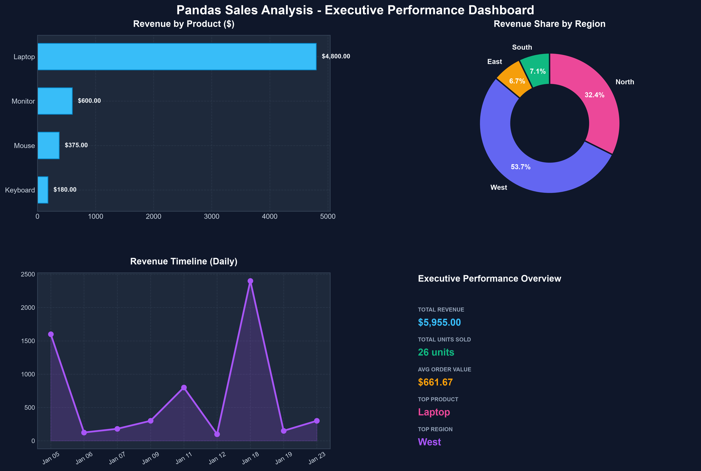

<div align="center">

# 📊 Pandas Sales Analysis & Executive Dashboard

[](https://github.com/Rajapakshaminindu/pandas-sales-analysis/actions)


[](https://opensource.org/licenses/MIT)

*An end-to-end Python data analysis pipeline, automated reporting engine, and interactive dashboard built with Pandas, Matplotlib, and Streamlit.*

</div>

---

## 🌟 Visual Executive Dashboard

The automated pipeline generates an executive performance dashboard on each run, capturing revenue breakdown by product, regional market share, and revenue timelines:

<div align="center">
  
</div>

---

## 🚀 Key Highlights & Features

- **Robust Data Cleaning Pipeline**: Automatically casts data types, handles invalid/missing records, and enforces schema integrity.
- **KPI Calculation Engine**: Calculates Total Revenue, Average Order Value (AOV), total units sold, top-performing product, and highest-grossing region.
- **Automated Visual Reporting**: Generates high-resolution multi-panel executive charts via Matplotlib.
- **Interactive Web Application**: Full-featured [Streamlit](https://streamlit.io/) dashboard for filtering, exploring, and downloading analytics in real-time.
- **CLI Support**: Customizable execution flags (`--input`, `--output-dir`, `--no-charts`).
- **Unit Tested**: Comprehensive test suite with [pytest](https://pytest.org/) ensuring data transformations are mathematically sound.
- **Continuous Integration (CI)**: Automated GitHub Actions workflow testing across Python 3.10, 3.11, 3.12, and 3.13 on every commit.

---

## 💡 Executive Insights from Data

From the retail transaction dataset, the pipeline identified key business insights:
- **Top Revenue Driver**: **Laptop** generated **$4,800.00** (~80.6% of total revenue) across 6 units sold.
- **Top Volume Product**: **Mouse** with **15 units sold** across multiple regions.
- **Leading Region**: The **West** region generated the highest revenue (**$3,200.00**), followed by **North** ($1,930.00).
- **Average Order Value (AOV)**: **$661.67** across 9 validated orders.

---

## 📂 Project Structure

```text
pandas-sales-analysis/
├── .github/
│   └── workflows/
│       └── ci.yml             # GitHub Actions CI workflow (lint & test)
├── assets/
│   └── sales_dashboard.png    # Auto-generated executive dashboard
├── src/
│   ├── __init__.py
│   ├── sales_analyzer.py      # Core modular SalesAnalyzer engine
│   └── visualize.py           # Matplotlib charting engine
├── tests/
│   ├── __init__.py
│   └── test_analysis.py       # Pytest unit & integration test suite
├── app.py                     # Streamlit interactive web dashboard
├── pandas_sales_analysis.py   # CLI & pipeline runner
├── sales_data.csv             # Raw input dataset
├── clean_sales_data.csv       # Cleaned & processed dataset
├── product_summary.csv        # Product performance aggregation
├── region_summary.csv         # Regional performance aggregation
├── requirements.txt           # Project dependencies
├── CONTRIBUTING.md            # Guidelines for open-source contributions
├── LICENSE                    # MIT License
└── README.md                  # Project documentation
```

---

## ⚡ Quickstart

### 1. Clone the repository
```bash
git clone https://github.com/Rajapakshaminindu/pandas-sales-analysis.git
cd pandas-sales-analysis
```

### 2. Set up virtual environment & install requirements
```bash
# Optional: Create and activate virtual environment
python -m venv venv
# On Windows:
venv\Scripts\activate
# On macOS/Linux:
# source venv/bin/activate

pip install -r requirements.txt
```

### 3. Run the analysis pipeline
```bash
python pandas_sales_analysis.py
```
This will:
- Process `sales_data.csv`
- Display summary metrics and diagnostics in the terminal
- Output `clean_sales_data.csv`, `product_summary.csv`, and `region_summary.csv`
- Render the high-resolution executive chart in `assets/sales_dashboard.png`

### 4. Launch the interactive Streamlit dashboard
```bash
streamlit run app.py
```
Open [http://localhost:8501](http://localhost:8501) in your browser to interactively explore and filter your sales data!

---

## 🛠️ CLI Usage Options

You can customize the pipeline run via CLI flags:

```bash
python pandas_sales_analysis.py --help

Options:
  --input TEXT       Path to input sales CSV [default: sales_data.csv]
  --output-dir TEXT  Directory to save generated CSVs and charts [default: .]
  --no-charts        Skip generating visual dashboard chart
```

---

## 🧪 Running Unit Tests

Run the test suite using `pytest`:

```bash
python -m pytest -v
```

All 6 test cases validate data cleaning edge cases, missing values, revenue calculations, aggregation grouping, and export output integrity.

---

## 📚 Core Pandas Concepts Demonstrated

- **Data Ingestion**: `pd.read_csv()`
- **Exploration & Profiling**: `df.head()`, `df.isnull().sum()`, `len(df)`
- **Data Type Casting**: `pd.to_numeric()`, `pd.to_datetime()`
- **Data Cleaning**: `df.dropna(subset=[...])`, `errors="coerce"`
- **Feature Engineering**: Vectorized column calculations (`quantity * unit_price`)
- **Aggregations**: `df.groupby()`, `.agg()`, `.sum()`, `.round()`, `.sort_values()`
- **Data Exporting**: `df.to_csv()`

---

## 🤝 Contributing

Contributions are welcome! Please check out [CONTRIBUTING.md](CONTRIBUTING.md) for details on submitting issues and pull requests.

---

## 📄 License

This project is licensed under the [MIT License](LICENSE).
